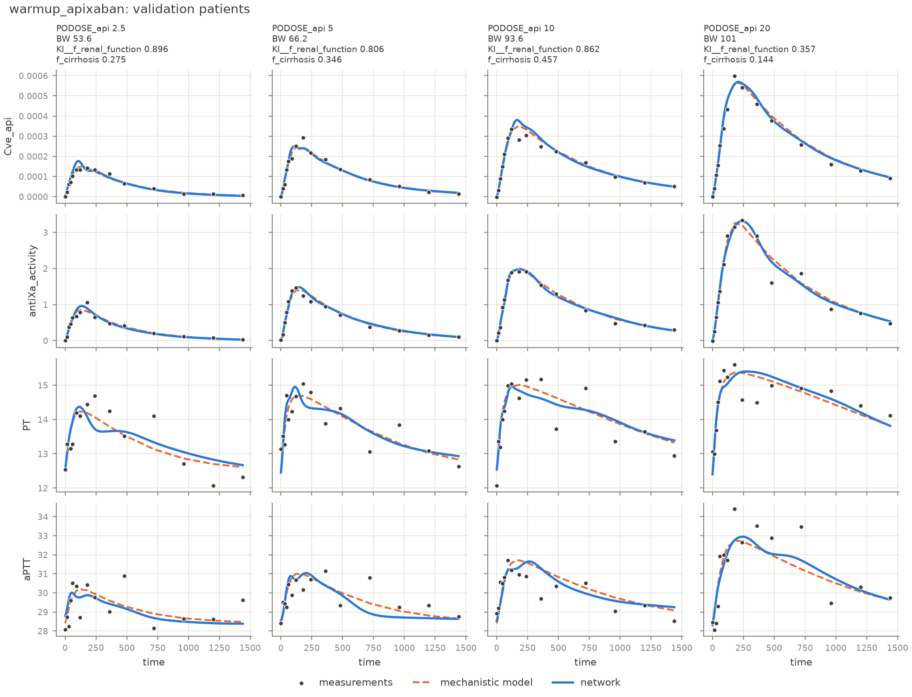

# Warm-up: a plain network

The first step of work package 2 has no hybrid model yet. A neural network learns the pharmacokinetics and pharmacodynamics of a panel of virtual patients, which the mechanistic model simulates. It sets up everything the hybrid variants need: the configuration of a case, the data generation, the networks, the loss, the training and the evaluation.

## The task

- **Panel data.** Many patients with one time course each, measured at common sampling times. The patients differ in the dose and in covariates, which are inputs of the mechanistic model.
- **One network, several inputs and outputs.** The network maps the time, the dose and the covariates of a patient to all observables at once, pharmacokinetics and pharmacodynamics.
- **Validation by patient.** A quarter of the patients is held out; no patient contributes measurements to both parts.

## A case is one file

The code contains no model ids, doses, units or covariates. A case is a TOML file; another substance is another file:

```toml
--8<-- "hybrid/configs/warmup_apixaban.toml"
```

The ids of the dose target, the covariates and the observables are checked against the model before the simulation. `hybrid/configs/warmup_absorption.toml` is the same warm-up on the small [example model](../sbml2jax/generated-module.md) of this documentation; the tests run it through the same code.

## Running it

```bash
cd hybrid
uv sync --extra dev
uv run hybrid train configs/warmup_apixaban.toml      # about one minute on a CPU
```

| command | |
| --- | --- |
| `hybrid generate CONFIG` | simulates the panel and saves it |
| `hybrid train CONFIG` | generates the panel if it does not exist, trains the network and evaluates it |
| `hybrid evaluate RUN` | writes the metrics and figures of a run again, from its saved weights |

In Google Colab, the notebook [`hybrid/notebooks/warmup.ipynb`](https://colab.research.google.com/github/matthiaskoenig/neural-ode/blob/main/hybrid/notebooks/warmup.ipynb) installs the package, runs the same commands and writes to Google Drive.

## Generated files are not in the repository

Datasets, weights, logs and figures are written below one directory, the environment variable `HYBRID_RUNS` (default `~/.cache/hybrid/runs`); in Colab it points to a folder of Google Drive. The repository holds what regenerates them: the code, the case and the seed.

```text
$HYBRID_RUNS/
├── datasets/warmup_apixaban-e6549c6840/dataset.npz     the panel; the hash names the data settings
└── warmup_apixaban/20261115-095707-c64ce4e/            a run: time and commit
    ├── config.toml        the case as it was run
    ├── run.json           commit, seed, dataset, versions of the packages, device
    ├── weights.eqx        the trained network and error model
    ├── log.csv            training and validation loss
    ├── metrics.json       errors per observable, trained error model
    └── fits.png, parity.png, learning.png
```

The simulated data and the split are the same on every machine. The trained weights can differ in the last digits between a CPU and a GPU.

## How it works

1. **Population** (`hybrid.data.population`): the dose and the covariates of every patient are sampled from the distributions of the case.
2. **Simulation** (`hybrid.data.simulate`): all patients are simulated with the mechanistic model in batches, with one function compiled by `jax.jit` and batched by `jax.vmap`, see [Compilation and batching](../sbml2jax/simulation.md#compilation-and-batching). Normal noise with $\sigma = a + b \cdot y$ is added per observable.
3. **Network** (`hybrid.nn`): a multilayer perceptron on the time (linear and logarithmic), the dose and the covariates, each standardized on the training patients; positive inputs over a ratio scale enter as logarithm. The scaling constants are part of the network and saved with it.
4. **Loss** (`hybrid.training.loss`): the negative log-likelihood of the measurements under the combined error model $\sigma_k = a_k + b_k \, |\hat y_k|$. The additive part $a_k$ and the proportional part $b_k$ of every observable are trained with the network. Missing measurements are masked.
5. **Training** (`hybrid.training.fit`): Adam on batches of patients with a decaying learning rate, then L-BFGS on all training patients. The returned model is the one with the lowest loss on the validation patients.
6. **Evaluation** (`hybrid.evaluation`): errors against the measurements and against the simulated values without noise, and the figures.

`fit` and the loss know nothing about the warm-up; the hybrid variants train with the same functions.

## Result for apixaban

256 virtual patients (192 for training, 64 for validation) take 2.5 to 20 mg and differ in body weight, renal function and degree of cirrhosis. The observables are the plasma concentration, the anti-Xa activity, PT and aPTT at 15 sampling times over 24 hours.



Errors of the network against the mechanistic model without noise, on the validation patients:

| observable | R² | RMSE relative to the standard deviation | σ at the mean value, trained | in the data |
| --- | --- | --- | --- | --- |
| `Cve_api` | 0.995 | 0.068 | 1.9e-5 | 2.0e-5 |
| `antiXa_activity` | 0.996 | 0.061 | 0.12 | 0.13 |
| `PT` | 0.978 | 0.150 | 0.41 | 0.42 |
| `aPTT` | 0.965 | 0.186 | 0.85 | 0.91 |

- The network predicts patients it has not seen, and the training finds the size of the noise of every observable.
- For PT and aPTT, whose values stay in a narrow range, the additive and the proportional part of the noise cannot be told apart; only their sum at the measured values is found.
- The network has no knowledge of the system. Where the noise is large relative to the effect (PT, aPTT), its time courses have bumps which the mechanistic model cannot have, and it cannot predict outside the doses and covariates of the panel. This is the reason for the hybrid models: the mechanistic model gives the structure, and a network only replaces a term which is poorly known.

The figure and the table are regenerated by `uv run python examples/warmup.py configs/warmup_apixaban.toml ../docs/images/warmup-fits.png` in `hybrid/`.
